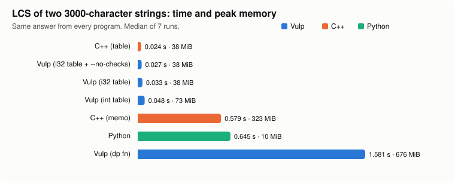

# Vulp V1: a language and compiler for competitive programming

**Project report** · Vibhaas · October 2026 · [github.com/vulp-lang/vulp](https://github.com/vulp-lang/vulp)

## Summary

Vulp is a small, statically typed language built for competitive programming (CP), with an
LLVM-based compiler, `vulpc`. It keeps the speed of C++ and drops the boilerplate. The
things contest problems need all the time are built in:

- testcase loops (`TC:`);
- fast token-based input (`read int[n] a;`);
- memoised recursion (`dp fn`);
- integers of any width up to 256 bits.

A program can be run straight from source through the LLVM JIT, or compiled to a native
executable.

Measured on six classic problems against idiomatic C++ (`g++ -O2`) and Python 3.12. Every
implementation printed byte-identical output, and each time is the median of 7 interleaved
runs:

| Result | Number |
|---|---|
| **Runtime**: 4 of 6 problems | 0.90×–1.09× of C++ |
| **Runtime**: map-heavy problem | 1.46× of C++ |
| **Runtime**: DP-table problem | 1.88× of C++ with `int`; **1.13×** with `i32` elements and `--no-checks` |
| **Speed vs Python** | **4.5×–13.9× faster** on 5 of 6 problems; Python's `dict` wins the map problem (0.86×) |
| **Source size vs C++** | **30–81% fewer tokens** on 5 of 6 problems; Dijkstra is 51% longer because V1 has no priority queue |
| **Build time** | **0.09–0.13 s** with `vulpc` vs 1.38–1.49 s with `g++`: about **14× faster** |
| **JIT run** | compile-in-memory-and-run adds only **≈ 20–45 ms** over running a prebuilt binary |
| **`dp fn`** | the keyword alone turns naive `fib(42)` from **0.92 s into < 0.01 s** |
| **`dp fn` cost** | 34× slower than a hand-written table on a 9-million-state DP, and 2.8× slower than hand-memoised C++ |
| **Runtime checks** | bounds and division checks cost **≤ 10%**, and are within ±3% (noise) on 6 of 7 programs |
| **Quality** | 142 unit tests, 34 end-to-end programs run 3 ways, 20 compile-error tests, 10 examples, 88 AddressSanitizer runs with 0 reports |
| **Independent review** | 7 rounds; 24 findings fixed before the reviewer was satisfied |

---

## Contents

1. [Why Vulp](#1-why-vulp)
2. [Vulp by example](#2-vulp-by-example)
3. [How the compiler works](#3-how-the-compiler-works)
4. [Evaluation](#4-evaluation)
5. [Correctness and quality](#5-correctness-and-quality)
6. [Limitations and future work](#6-limitations-and-future-work)
7. [Reproducing the results](#7-reproducing-the-results)
8. [Appendix: full results](#appendix-full-results)

---

## 1. Why Vulp

Competitive programmers mostly pick between two languages:

- **C++**: fast, but every solution starts with the same fast-I/O incantations, a testcase
  loop, and hand-written memo tables. Mistakes such as out-of-bounds indexes or uninitialised
  variables fail silently.
- **Python**: short to write, but often 5–25× too slow for the time limit (see
  [§4.2](#42-runtime)).

Vulp takes the constructs CP code is made of and makes them part of the language, then
compiles them through LLVM so the result runs at C++ speed. The V1 scope was fixed up front:

- integer types `iN`/`uN` whose width rounds up to 8/16/32/64/128/256 bits, and range types
  `int<lo..hi>`;
- `int`, `char`, `bool`, `float`, `string`, arrays, `vec`, `map`, `struct`, range arrays
  `[1..10]`;
- `if`/`elif`/`else`, `while`, C-style `for` and `for x in`;
- functions;
- `print`/`println`/`read`;
- `dp fn`;
- the `TC:` testcase block.

Four semantic choices were made with the user before implementation began:

- ranges are **inclusive**;
- `int` is **64-bit**;
- a `dp fn` may **read** globals (its cache then resets automatically for each testcase);
- containers have **value semantics** (deep copies).

---

## 2. Vulp by example

Every program in this section is in [`examples/`](../../examples) with its input and
expected output, and all of them are run by the test suite.

### 2.1 Hello, and how to run a program

```text
println("Hello from Vulp!");
```

```console
$ vulpc examples/01_hello.vp                 # JIT: compile in memory and run
Hello from Vulp!
$ vulpc examples/01_hello.vp -o hello        # or build a native executable
$ ./hello
Hello from Vulp!
```

A program is a list of statements that run top to bottom, plus `fn` and `struct`
definitions. There is no `main`, and nothing needs importing.

### 2.2 The testcase loop: `TC:` and `read`

Almost every CP problem starts with "the first line contains *t*, the number of testcases".
In Vulp that is one construct:

<table>
<tr><th>Vulp (10 lines, 59 tokens)</th><th>C++ (20 lines, 134 tokens)</th></tr>
<tr><td>

```text
TC: {
    read int n;
    read int[n] a;
    int best = a[0], cur = 0;
    for x in a: {
        cur = max(cur + x, x);
        best = max(best, cur);
    }
    println(best);
}
```

</td><td>

```cpp
#include <bits/stdc++.h>
using namespace std;
int main() {
    ios::sync_with_stdio(false);
    cin.tie(nullptr);
    int t;
    cin >> t;
    while (t--) {
        int n;
        cin >> n;
        vector<long long> a(n);
        for (auto& x : a) cin >> x;
        long long best = a[0], cur = 0;
        for (long long x : a) {
            cur = max(cur + x, x);
            best = max(best, cur);
        }
        cout << best << "\n";
    }
}
```

</td></tr></table>

The Vulp version runs 200,000 testcases in **0.071 s**, against **0.073 s** for the C++
([§4.2](#42-runtime)). `read` uses a buffered reader, so it needs no `sync_with_stdio` tricks.
Output is flushed automatically before the program waits for more input, so interactive
problems work too.

### 2.3 Memoised recursion: `dp fn`

Write the recurrence; `dp` caches it.

```text
dp fn fib(int n) -> int {
    if n <= 1: return n;
    return fib(n - 1) + fib(n - 2);
}
println(fib(42));
```

| Version | `fib(42)` |
|---|---|
| `fn fib` (naive recursion, 867 million calls) | 0.92 s |
| `dp fn fib` (43 distinct states) | **< 0.01 s** |

The compiler checks that a `dp fn` is safe to cache:

- its parameters must be integers, chars or bools;
- its result must be a scalar;
- it must not write globals or do I/O, directly or through anything it calls.

If it **reads** globals, as the longest-common-subsequence (LCS) function below reads the
strings `a` and `b`, the compiler arranges for its cache to be cleared before every
testcase, in O(1) time:

```text
string a, b;
dp fn lcs(int i, int j) -> int {
    if i == a.len() || j == b.len(): return 0;
    if a[i] == b[j]: return 1 + lcs(i + 1, j + 1);
    return max(lcs(i + 1, j), lcs(i, j + 1));
}
TC: {
    read(a, b);
    println(lcs(0, 0));
}
```

```console
$ vulpc -v examples/08_lcs_testcases.vp < examples/08_lcs_testcases.in
[vulpc] dp fn lcs: memoised; cache cleared before every TC iteration (reads globals)
...
4
4
0
```

The equivalent hand-written C++ needs a global hash map, a key-packing scheme, and someone
to remember to clear it between testcases. [§4.5](#45-the-price-of-dp-fn) measures what the
convenience costs.

### 2.4 Integer widths

Widths are rounded up to the next power of two, and range types pick their own width:

```text
int<0..1000000007> mod_value = 1000000007;   # needs 31 bits -> stored as i32
i21 small = 1000000;                          # stored as i32
i256 f = 1;
for i in [1..50]: f *= i;                     # 50! needs 215 bits
println("50! = ", f);
u128 two = 1;
two <<= 127;
println("2^127 = ", two);
read i128 x, y;
println(x * y);
```

```console
50! = 30414093201713378043612608166064768844377641568960512000000000000
2^127 = 170141183460469231731687303715884105728
```

Widths are **storage** widths. Arithmetic on narrower types is done in 64 bits, so
`int<0..100000> x; x * x` cannot overflow. Choosing a narrow element type is a real
optimisation: an `i32` DP table halves memory and runs 1.4× faster than an `int` table
([§4.6](#46-ablations-runtime-checks-and-integer-widths)).

### 2.5 Containers, maps and structs

```text
read int n;
map<string, int> count;
for i in [1..n]: {
    read string w;
    count[w] += 1;                 # missing keys start at 0
}
for w in count: println(w, " ", count[w]);     # keys in sorted order
```

```text
struct Edge { int to; int w; }
vec<Edge>[n + 1] adj;               # n+1 empty adjacency lists
adj[u].push(Edge(v, w));
for e in adj[u]: { ... e.to ... e.w ... }
```

All values, including `vec`, `map`, `string` and structs, have value semantics:
assignment copies. Large containers are passed with `&` to avoid copying:

```text
fn dfs(int u, vec<int>[]& adj, bool[]& seen) {
    seen[u] = true;
    for v in adj[u]: if !seen[v]: dfs(v, adj, seen);
}
```

Memory is freed deterministically, with no garbage collector and no leaks: a value is
freed when it is overwritten, when its declaration runs again, or when its function
returns. Programs run on a 1 GiB stack, so recursion a million levels deep (a DFS on a path
graph) works.

### 2.6 Mistakes caught for you

**At compile time**, with the source line and a caret (exit code 65):

```text
type.vp:2:6: semantic error: condition of 'if' must be bool, found i64
    if n % 2: println("odd");
         ^
```

```text
purity.vp:3:5: semantic error: dp function 'f' must not modify global variables (its results are cached)
        calls += 1;
        ^
```

```text
dangle.vp:6:11: semantic error: cannot pass an element of 'all' by reference together with
'all' itself: 'grow' could resize or replace the container and leave the element reference dangling
    grow(all, all[0]);
              ^
```

**At run time**, a clear message instead of silently wrong answers (exit code 1):

```text
vulp runtime error (line 3): index 3 out of bounds for length 3
```

Runtime checks cover indexes, division by zero, `pop()` on an empty container, reading past
the end of input, and input integers too large for their type. They cost at most 10%
([§4.6](#46-ablations-runtime-checks-and-integer-widths)), and `--no-checks` removes them.

---

## 3. How the compiler works

```text
prog.vp ─► Lexer ─► Parser (Pratt) ─► Semantic analysis ─► LLVM IR codegen ─► LLVM -O2 ─┬─► ORC JIT: run in memory
           tokens   AST              typed AST, purity,     + runtime calls              └─► object ─► c++ link ─► executable
                                     & aliasing rules                                          + libvulprt.a
```

| Component | Lines of C++ (non-blank) | What it does |
|---|---:|---|
| Lexer | 471 | tokens, `iN`/`uN` type names, literals with `_`, 1-based locations |
| Parser + AST | 1,136 | Pratt expression parser, per-statement error recovery, S-expression dump |
| Semantic analysis | 1,733 | interned types, width rounding, scopes, literal typing, `dp` purity fixpoint, `&` aliasing rules |
| Code generation | 1,945 | LLVM IR for every construct; generated deep-copy / free / print / read helpers per type; `dp` memo wrappers |
| Driver, diagnostics, CLI | 502 | pass pipeline, JIT, object emission, linking, exit codes |
| Runtime library | 1,031 | buffered I/O, 8–256-bit integer printing and parsing, vectors, maps, memo tables |
| **Total compiler + runtime** | **6,818** | |
| Unit tests | 1,626 | 142 test cases across all stages |

Some design points:

- **`dp fn f`** becomes three pieces:
  - a hash table;
  - the body;
  - a wrapper that every caller (including the body itself) goes through: it looks the
    arguments up, and on a miss runs the body and stores the result.
  
  Table entries carry a generation number, so clearing a cache for a new testcase is O(1).
- **Value semantics without a garbage collector:** every heap buffer has exactly one owner.
  Copying a stored value calls a per-type deep-copy helper, and temporaries are moved
  without copying. Per-type free helpers run on overwrite, re-declaration and function exit.
- **Same code, two back ends:** the JIT path loads the runtime from the compiler process
  itself, and the native path links `libvulprt.a`.

Details are in [docs/architecture.md](../architecture.md).

---

## 4. Evaluation

### 4.1 Method

| | |
|---|---|
| Machine | AMD EPYC 9654P (96 cores), Linux 6.17, shared machine |
| Vulp | `vulpc -O2 prog.vp -o prog` (LLVM 18.1.3) |
| C++ | `g++ -O2 -std=c++20` (GCC 13.3), idiomatic CP style: `<bits/stdc++.h>`, untied `cin`/`cout` |
| Python | CPython 3.12.3, idiomatic: `sys.stdin.buffer.read().split()`, built-ins |
| Runs | 7 timing rounds, each implementation run once per round (interleaved), all pinned to one CPU; median reported, min–max in the appendix |
| Correctness | the SHA-256 of every implementation's output must be identical, or the harness aborts |
| Memory | peak resident set (max RSS) from `/usr/bin/time` |
| Code size | non-blank, non-comment lines, and tokens (identifiers, numbers, strings and operators) |
| Inputs | generated with fixed seeds by [`bench/gen_inputs.py`](bench/gen_inputs.py) (up to 19 MB) |

The machine is shared with other users, so the interleaving matters: an early
non-interleaved run measured one program 60% slower purely because of a busy neighbour.
With interleaving, the fastest and slowest of the 7 runs are within 5% of each other for 13
of the 20 configurations. The largest spread, 20%, is on the 50 ms sieve runs, where a few
milliseconds of noise is a large fraction. The appendix lists every min–max range.

| Problem | Input | What it stresses |
|---|---|---|
| Sieve | count primes ≤ 2·10⁷ | tight loops over a `bool` array |
| Sort + I/O | read, sort and print 10⁶ integers | input parsing, sorting, output formatting |
| LCS | two random 3000-character DNA strings | 2-D dynamic programming, 9·10⁶ states |
| Dijkstra | 10⁵ vertices, 5·10⁵ weighted edges | adjacency lists of structs, heap, references |
| Testcases | 2·10⁵ testcases of 1–9 numbers (max subarray sum) | `TC:` overhead, many small reads and writes |
| Map count | 10⁶ insertions of 64-bit keys, 2·10⁵ distinct | ordered map |

### 4.2 Runtime


| Problem | Vulp (s) | C++ (s) | Python (s) | Vulp vs C++ | Vulp vs Python |
|---|---:|---:|---:|---:|---:|
| Sieve | 0.056 | 0.051 | 0.645 | 1.09× | 11.5× faster |
| Sort + I/O | 0.134 | 0.148 | 0.608 | **0.90×** | 4.5× faster |
| LCS (table) | 0.060 | 0.032 | 0.833 | 1.88× | 13.9× faster |
| Dijkstra | 0.121 | 0.122 | 0.814 | **0.99×** | 6.7× faster |
| Testcases | 0.071 | 0.073 | 0.383 | **0.98×** | 5.4× faster |
| Map count | 0.433 | 0.295 | 0.373 | 1.46× | 0.86× (slower) |

- **Equal to C++** on sieve, Dijkstra and the testcase loop; **10% faster** on sort + I/O,
  because Vulp's buffered reader and integer printer beat even untied `iostream`s.
- **The LCS table** gap is mostly the element type: the Vulp program uses 64-bit `int`
  where the C++ uses 32-bit `int`. With `i32` elements Vulp needs the same memory as C++
  (37.6 MiB) and runs in 0.043 s, or 0.036 s with `--no-checks` (1.13× of C++)
  ([§4.6](#46-ablations-runtime-checks-and-integer-widths)).
- **The map** is 1.46× slower than `std::map`. Every operation is a call into the runtime,
  and each entry's value lives in a separate allocation (two allocations per insert instead
  of one). The final loop also looks each key up again (`cnt[k]`), because V1's map
  iteration yields keys only. Python's hash `dict` beats both here, since nothing needs
  ordering until the end.

### 4.3 Source size


| Problem | Vulp | C++ | Python | Vulp vs C++ |
|---|---:|---:|---:|---:|
| Sieve | 83 | 143 | 105 | −42% |
| Sort + I/O | **22** | 118 | 72 | −81% |
| LCS (`dp fn`) / (table) | 108 / 138 | 196 | 158 | −45% / −30% |
| Dijkstra | 518 | 344 | 266 | +51% |
| Testcases | 59 | 134 | 150 | −56% |
| Map count | 86 | 146 | 113 | −41% |

Vulp is the shortest of the three languages on five of the six problems, and shorter than
Python as well as C++. Sort + I/O is the whole program:

```text
read int n;
read int[n] a;
a.sort();
println(a);
```

Dijkstra is the exception, because V1 has no priority queue and the program carries a
30-line binary heap. That is the most valuable library addition for V2
([§6](#6-limitations-and-future-work)).

### 4.4 Build time and JIT


`vulpc` builds a native executable in **0.09–0.13 s**; `g++` takes **1.38–1.49 s**, mostly
spent parsing `<bits/stdc++.h>`. A precompiled header would narrow that gap; most
contestants don't use one. In JIT mode, compiling in memory and running costs only
20–45 ms more than running a prebuilt binary (for example sieve: 0.081 s JIT vs 0.056 s
binary), so "edit, run, check" never waits on a compiler.

### 4.5 The price of `dp fn`



`dp fn` buys brevity and safety, not speed. On LCS with 9 million states:

| Implementation | Time | Memory | vs C++ table |
|---|---:|---:|---:|
| C++ bottom-up table | 0.032 s | 38 MiB | 1× |
| Vulp `i32` table + `--no-checks` | 0.036 s | 38 MiB | 1.13× |
| Vulp `int` table | 0.060 s | 72 MiB | 1.88× |
| C++ recursion memoised in `unordered_map` | 0.725 s | 323 MiB | 23× |
| Python bottom-up table | 0.833 s | 9 MiB | 26× |
| Vulp `dp fn` | 2.065 s | 675 MiB | 64× |

A memoised recursion is inherently slower than a table: each state costs a hash lookup and
a function call, in random memory order. The fair comparison is therefore hand-memoised C++,
and the Vulp memo table is **2.8× slower and 2.1× larger** than that. The causes are known
and fixable inside the runtime:

- keys are hashed byte by byte through a generic, non-inlined call;
- a cache miss probes the table twice (`get`, then `put`);
- 28-byte entries straddle cache lines;
- the table is at most half full, and every doubling rehashes every entry.

Specialising the table for the key size the compiler already knows, and returning the slot
from `get` to reuse in `put`, are the first steps ([§6](#6-limitations-and-future-work)).
For the usual CP sizes (up to about 10⁶ states) a `dp fn` finishes in well under a second.

### 4.6 Ablations: runtime checks and integer widths

| Program | Checks on | `--no-checks` | Overhead |
|---|---:|---:|---:|
| Sieve | 0.057 s | 0.059 s | −3% (noise) |
| Sort + I/O | 0.138 s | 0.138 s | +1% |
| LCS (`dp fn`) | 2.071 s | 2.062 s | +0% |
| LCS (`int` table) | 0.060 s | 0.054 s | **+10%** |
| Dijkstra | 0.124 s | 0.122 s | +2% |
| Testcases | 0.072 s | 0.071 s | +1% |
| Map count | 0.537 s | 0.552 s | −3% (noise) |

| LCS table element type | Time | Peak memory |
|---|---:|---:|
| `int` (64-bit) | 0.061 s | 72.0 MiB |
| `int` + `--no-checks` | 0.055 s | 72.1 MiB |
| `i32` | 0.043 s | 37.6 MiB |
| `i32` + `--no-checks` | 0.036 s | 37.5 MiB |

Bounds checks are nearly free except in the innermost loop of a dense DP, where they cost
10%. Choosing the element width matters more (1.4×), and it is a one-word change
(`int[n + 1][m + 1] dp;` → `i32[n + 1][m + 1] dp;`).

### 4.7 Memory

| Problem | Vulp | C++ | Python |
|---|---:|---:|---:|
| Sieve | 21.1 MiB | 21.1 MiB | 46.6 MiB |
| Sort + I/O | 10.5 MiB | 10.6 MiB | 185.7 MiB |
| Dijkstra | 19.6 MiB | 21.1 MiB | 171.8 MiB |
| Testcases | 3.1 MiB | 3.1 MiB | 86.8 MiB |
| Map count | 22.5 MiB | 15.1 MiB | 110.4 MiB |

Apart from the map's extra value blocks and the `dp fn` table discussed above, Vulp uses
the same memory as C++, and 2–28× less than Python. Deterministic frees keep loops that
copy containers in constant memory: one reviewer test went from 1 GB to 3 MB once frees
were implemented.

---

## 5. Correctness and quality

| Check | Count | Result |
|---|---:|---|
| Unit tests (lexer, parser, types, sema, runtime, codegen) | 142 | all pass |
| End-to-end programs, each run 3 ways: JIT, native binary, JIT with freed memory poisoned | 34 × 3 | all pass |
| Compile-error programs (expected message and exit code) | 20 | all pass |
| Examples (expected output; also run with freed memory poisoned) | 10 × 2 | all pass |
| AddressSanitizer runs of generated code + runtime (all e2e and examples, at -O0 and -O2) | 88 | 0 reports |
| Benchmark programs cross-checked against C++ and Python output | 7 | identical |

Development followed a 43-step plan ([docs/PLAN.md](../PLAN.md)), with tests landing at
each step. An **independent reviewer agent** then audited the compiler adversarially, in a
loop that continued until it was satisfied:

| Round | Findings | Examples |
|---|---:|---|
| 1 | 10 | memory never freed (1 GB for simple loops); `MIN / -1` undefined; `dp` cache clear O(capacity); silent input overflow; float formatting |
| 2 | 7 | `&` references could dangle when the callee resized the container; float→`i256` cast crashed LLVM; temporaries leaked |
| 3 | 3 | the dangling check could be bypassed through aliasing (`f(v, v)`) |
| 4 | 2 + 1 | crash on recursive structs in the alias check; index evaluation order |
| 5 | 2 | borrowed right-hand side of `+=` overwritten by a side effect in the index; evaluation order documented |
| 6 | 0 | **satisfied**: 300 generated evaluation-order programs, 110 of them under ASan |
| 7 | 0 | **satisfied** on the final sources |

That is 24 findings from the reviewer and 2 found while fixing them; all 26 were fixed and
each has a regression test.

---

## 6. Limitations and future work

V1 deliberately leaves out:

- lambdas;
- generics;
- custom comparators and sorting structs;
- fixed-precision float output;
- line-based input;
- runtime checking of `int<lo..hi>`.

The rules against dangling `&` references are conservative and reject a few safe calls.
`docs/language.md` lists every limit.

From the measurements, the most valuable next steps are:

1. **A priority queue and a sorted set** (`pq<T>`, `set<T>`). They would remove the
   hand-written heap that makes Dijkstra Vulp's only longer-than-C++ program.
2. **A faster memo table**: specialise it by key size, do one probe per miss, use a compact
   entry layout, and allow preallocation. Target: at least parity with C++ `unordered_map`
   memoisation (currently 2.8× behind).
3. **A faster map**: store values inline in the tree node, and iterate over key–value pairs
   (`for k, v in m`) so the extra lookups go away (currently 1.46× behind `std::map`).
4. **Width inference for DP tables**: suggest `i32` when the values provably fit, since that
   is worth 1.4× on dense DPs.

---

## 7. Reproducing the results

```bash
cmake -S . -B build -G Ninja && cmake --build build      # LLVM 18, CMake, a C++20 compiler
(cd build && ctest)                                      # the full test suite (7 groups)
python3 docs/report/bench/run_bench.py                   # generates inputs, builds, runs, verifies -> results.json
python3 docs/report/bench/ablation.py                    # checks / widths ablations -> ablation.json
python3 docs/report/bench/make_figures.py                # figures/*.svg and bench/results_tables.md
docs/report/bench/dp_fib/run.sh                          # fib(42) with and without dp
python3 docs/presentation/build_deck.py                  # the slide deck, from the same results
```

Absolute times depend on the machine. The ratios are what to compare.

---

## Appendix: full results

The tables below are generated by `make_figures.py`
([bench/results_tables.md](bench/results_tables.md)); the raw data is in
[bench/results.json](bench/results.json) and [bench/ablation.json](bench/ablation.json).

| Problem | Implementation | Time (s) | Min–max (s) | vs C++ | Peak RSS (MiB) | Lines | Tokens | Build (s) | JIT run (s) |
|---|---|---:|---:|---:|---:|---:|---:|---:|---:|
| Sieve (n = 2·10⁷) | Vulp | 0.056 | 0.055–0.066 | 1.09× | 21.1 | 10 | 83 | 0.10 | 0.081 |
| Sieve (n = 2·10⁷) | C++ | 0.051 | 0.050–0.060 | 1.00× | 21.1 | 17 | 143 | 1.39 | – |
| Sieve (n = 2·10⁷) | Python | 0.645 | 0.628–0.707 | 12.53× | 46.6 | 14 | 105 | – | – |
| Sort + I/O (10⁶ ints) | Vulp | 0.134 | 0.133–0.134 | 0.90× | 10.5 | 4 | 22 | 0.09 | 0.157 |
| Sort + I/O (10⁶ ints) | C++ | 0.148 | 0.146–0.152 | 1.00× | 10.6 | 12 | 118 | 1.42 | – |
| Sort + I/O (10⁶ ints) | Python | 0.608 | 0.604–0.612 | 4.12× | 185.7 | 7 | 72 | – | – |
| LCS (3000 × 3000) | Vulp (dp fn) | 2.065 | 2.055–2.075 | 64.13× | 674.7 | 8 | 108 | 0.10 | 2.099 |
| LCS (3000 × 3000) | Vulp (table) | 0.060 | 0.060–0.062 | 1.88× | 72.1 | 12 | 138 | 0.09 | 0.092 |
| LCS (3000 × 3000) | C++ (table) | 0.032 | 0.031–0.034 | 1.00× | 37.6 | 14 | 196 | 1.42 | – |
| LCS (3000 × 3000) | C++ (memo) | 0.725 | 0.723–0.746 | 22.52× | 323.0 | 19 | 212 | 1.46 | – |
| LCS (3000 × 3000) | Python | 0.833 | 0.828–0.839 | 25.88× | 9.1 | 16 | 158 | – | – |
| Dijkstra (10⁵ V, 5·10⁵ E) | Vulp | 0.121 | 0.119–0.123 | 0.99× | 19.6 | 56 | 518 | 0.13 | 0.165 |
| Dijkstra (10⁵ V, 5·10⁵ E) | C++ | 0.122 | 0.120–0.124 | 1.00× | 21.1 | 35 | 344 | 1.49 | – |
| Dijkstra (10⁵ V, 5·10⁵ E) | Python | 0.814 | 0.807–0.823 | 6.69× | 171.8 | 26 | 266 | – | – |
| 2·10⁵ testcases | Vulp | 0.071 | 0.071–0.072 | 0.98× | 3.1 | 10 | 59 | 0.11 | 0.099 |
| 2·10⁵ testcases | C++ | 0.073 | 0.072–0.074 | 1.00× | 3.1 | 20 | 134 | 1.38 | – |
| 2·10⁵ testcases | Python | 0.383 | 0.382–0.386 | 5.24× | 86.8 | 18 | 150 | – | – |
| Map count (10⁶ ops) | Vulp | 0.433 | 0.408–0.470 | 1.46× | 22.5 | 9 | 86 | 0.10 | 0.451 |
| Map count (10⁶ ops) | C++ | 0.295 | 0.291–0.314 | 1.00× | 15.1 | 18 | 146 | 1.42 | – |
| Map count (10⁶ ops) | Python | 0.373 | 0.369–0.390 | 1.26× | 110.4 | 14 | 113 | – | – |

Benchmark sources: [`bench/`](bench) — one folder per problem with the `.vp`, `.cpp` and `.py`
versions.
