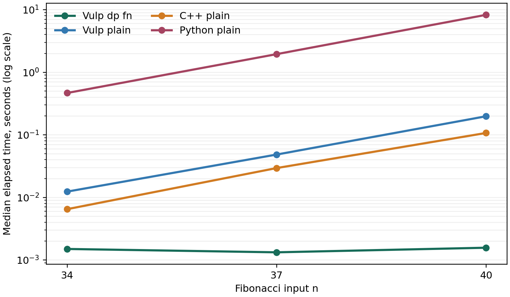
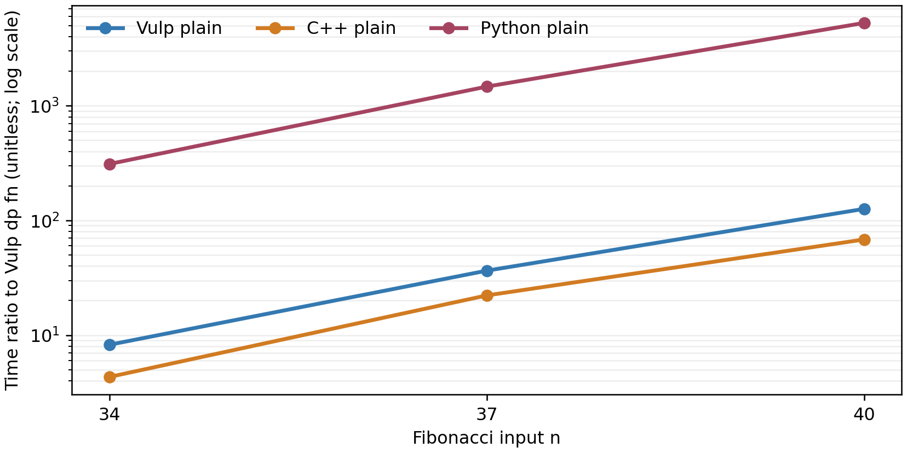
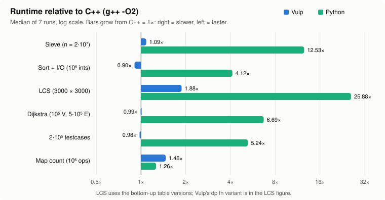
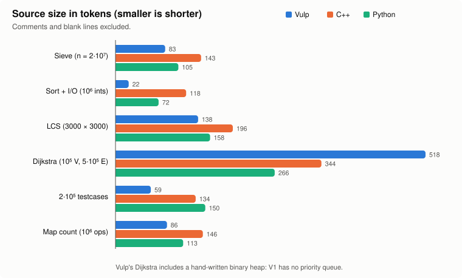
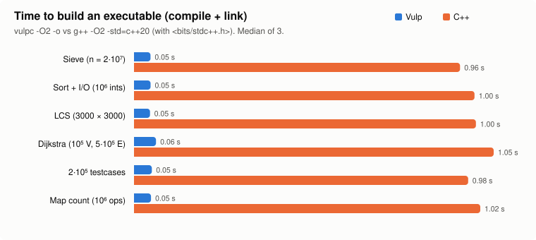

# Vulp V1: a language and compiler for competitive programming

**Project report** · Vibhaas · October 2026 · [github.com/vulp-lang/vulp](https://github.com/vulp-lang/vulp)

The formal Phase 1 Review 2 report is available as a [PDF](phase1_review2/report.pdf),
with its [LaTeX source and figures](phase1_review2/).

## Summary

Vulp is a small, statically typed language built for competitive programming (CP), with an
LLVM-based compiler, `vulpc`. It provides syntax for several recurring parts of contest
programs:

- testcase loops (`TC:`);
- fast token-based input (`read int[n] a;`);
- memoised recursion (`dp fn`);
- integers of any width up to 256 bits.

A program can be run straight from source through the LLVM JIT, or compiled to a native
executable.

Measured on six classic problems against idiomatic C++ (`g++ -O2`) and Python 3.12. Every
implementation printed byte-identical output, and each time is the median of 7 interleaved
runs:

| Result | Number |
|---|---|
| **Runtime**: 4 of 6 problems | 0.90x-1.17x of C++ on the reference laptop |
| **Runtime**: map-heavy problem | 1.42x of C++ |
| **Runtime**: DP-table problem | 1.37x of C++ with 32-bit table elements in both languages and Vulp checks enabled |
| **Speed vs Python** | 4.6x-19.5x faster on 5 of 6 problems; nearly equal on map counting |
| **Source size vs C++** | **30–81% fewer tokens** on 5 of 6 problems; Dijkstra is 51% longer because V1 has no priority queue |
| **Build time** | 0.05-0.06 s with `vulpc` vs 0.96-1.05 s with `g++` on these sources |
| **JIT run** | compile-in-memory-and-run adds roughly 16-35 ms over running a prebuilt binary |
| **`dp fn`** | on `fib(40)`, 0.00157 s versus 0.198 s for plain Vulp recursion, 0.107 s for plain C++, and 8.26 s for plain Python recursion |
| **`dp fn` tradeoff** | automatic caching removes repeated recursion, but a hand-written table is still much faster on a dense 9-million-state LCS problem |
| **Runtime checks** | about 11% on the dense LCS table and 0-2% on the other measured programs |
| **Quality** | 142 unit tests, 34 end-to-end programs run 3 ways, 20 compile-error tests, 10 examples, 88 AddressSanitizer runs with 0 reports |
| **Independent review** | 7 rounds; 24 findings fixed before the reviewer was satisfied |

---

## Contents

1. [Why Vulp](#1-why-vulp)
2. [Vulp by example](#2-vulp-by-example)
3. [How the compiler works](#3-how-the-compiler-works)
4. [Evaluation](#4-evaluation)
5. [Correctness and quality](#5-correctness-and-quality)
6. [Limitations and future work](#6-limitations-and-future-work)
7. [Reproducing the results](#7-reproducing-the-results)
8. [Appendix: full results](#appendix-full-results)

---

## 1. Why Vulp

Competitive programmers mostly pick between two languages:

- **C++**: fast, but every solution starts with the same fast-I/O incantations, a testcase
  loop, and hand-written memo tables. Mistakes such as out-of-bounds indexes or uninitialised
  variables fail silently.
- **Python**: concise, though its runtime varies by task. In this six-task comparison,
  Vulp is 4.6x-19.5x faster on five tasks and nearly equal on map counting (see
  [§4.2](#42-runtime)).

Vulp takes the constructs CP code is made of and makes them part of the language, then
compiles them through LLVM so the result runs at C++ speed. The V1 scope was fixed up front:

- integer types `iN`/`uN` whose width rounds up to 8/16/32/64/128/256 bits, and range types
  `int<lo..hi>`;
- `int`, `char`, `bool`, `float`, `string`, arrays, `vec`, `map`, `struct`, range arrays
  `[1..10]`;
- `if`/`elif`/`else`, `while`, C-style `for` and `for x in`;
- functions;
- `print`/`println`/`read`;
- `dp fn`;
- the `TC:` testcase block.

Four semantic choices were made with the user before implementation began:

- ranges are **inclusive**;
- `int` is **64-bit**;
- a `dp fn` may **read** globals (its cache then resets automatically for each testcase);
- containers have **value semantics** (deep copies).

---

## 2. Vulp by example

Every program in this section is in [`examples/`](../../examples) with its input and
expected output, and all of them are run by the test suite.

### 2.1 Hello, and how to run a program

```text
println("Hello from Vulp!");
```

```console
$ vulpc examples/01_hello.vp                 # JIT: compile in memory and run
Hello from Vulp!
$ vulpc examples/01_hello.vp -o hello        # or build a native executable
$ ./hello
Hello from Vulp!
```

A program is a list of statements that run top to bottom, plus `fn` and `struct`
definitions. There is no `main`, and nothing needs importing.

### 2.2 The testcase loop: `TC:` and `read`

Almost every CP problem starts with "the first line contains *t*, the number of testcases".
In Vulp that is one construct:

<table>
<tr><th>Vulp (10 lines, 59 tokens)</th><th>C++ (20 lines, 134 tokens)</th></tr>
<tr><td>

```text
TC: {
    read int n;
    read int[n] a;
    int best = a[0], cur = 0;
    for x in a: {
        cur = max(cur + x, x);
        best = max(best, cur);
    }
    println(best);
}
```

</td><td>

```cpp
#include <bits/stdc++.h>
using namespace std;
int main() {
    ios::sync_with_stdio(false);
    cin.tie(nullptr);
    int t;
    cin >> t;
    while (t--) {
        int n;
        cin >> n;
        vector<long long> a(n);
        for (auto& x : a) cin >> x;
        long long best = a[0], cur = 0;
        for (long long x : a) {
            cur = max(cur + x, x);
            best = max(best, cur);
        }
        cout << best << "\n";
    }
}
```

</td></tr></table>

The Vulp version runs 200,000 testcases in **0.055 s**, against **0.055 s** for the C++
([§4.2](#42-runtime)). `read` uses a buffered reader, so it needs no `sync_with_stdio` tricks.
Output is flushed automatically before the program waits for more input, so interactive
problems work too.

### 2.3 Memoised recursion: `dp fn`

Write the recurrence; `dp` caches it.

```text
dp fn fib(int n) -> int {
    if n <= 1: return n;
    return fib(n - 1) + fib(n - 2);
}
read int n;
println(fib(n));
```

| Version | `fib(40)`, median elapsed time |
|---|---:|
| Vulp `dp fn` (41 distinct states) | **0.00157 s** |
| Vulp plain recursion | 0.198 s |
| C++ plain recursion | 0.107 s |
| Python plain recursion | 8.26 s |

These four programs read the same input, use the same recurrence, and print the same result. The three plain
versions do not cache answers; `dp fn` adds that behavior with one keyword. The fresh-process
timings include startup and are close to the startup floor for the `dp fn` case. Three
interleaved runs at each of `n = 34, 37, 40` are recorded in
[`bench/dp_fib/results_cross_language.json`](bench/dp_fib/results_cross_language.json),
with the runnable harness in [`bench/dp_fib/benchmark.py`](bench/dp_fib/benchmark.py).





The compiler checks that a `dp fn` is safe to cache:

- its parameters must be integers, chars or bools;
- its result must be a scalar;
- it must not write globals or do I/O, directly or through anything it calls.

If it **reads** globals, as the longest-common-subsequence (LCS) function below reads the
strings `a` and `b`, the compiler arranges for its cache to be cleared before every
testcase, in O(1) time:

```text
string a, b;
dp fn lcs(int i, int j) -> int {
    if i == a.len() || j == b.len(): return 0;
    if a[i] == b[j]: return 1 + lcs(i + 1, j + 1);
    return max(lcs(i + 1, j), lcs(i, j + 1));
}
TC: {
    read(a, b);
    println(lcs(0, 0));
}
```

```console
$ vulpc -v examples/08_lcs_testcases.vp < examples/08_lcs_testcases.in
[vulpc] dp fn lcs: memoised; cache cleared before every TC iteration (reads globals)
...
4
4
0
```

The equivalent hand-written C++ needs a global hash map, a key-packing scheme, and someone
to remember to clear it between testcases. [§4.5](#45-the-price-of-dp-fn) measures what the
convenience costs.

### 2.4 Integer widths

Widths are rounded up to the next power of two, and range types pick their own width:

```text
int<0..1000000007> mod_value = 1000000007;   # needs 31 bits -> stored as i32
i21 small = 1000000;                          # stored as i32
i256 f = 1;
for i in [1..50]: f *= i;                     # 50! needs 215 bits
println("50! = ", f);
u128 two = 1;
two <<= 127;
println("2^127 = ", two);
read i128 x, y;
println(x * y);
```

```console
50! = 30414093201713378043612608166064768844377641568960512000000000000
2^127 = 170141183460469231731687303715884105728
```

Widths are **storage** widths. Arithmetic on narrower types is done in 64 bits, so
`int<0..100000> x; x * x` cannot overflow. Choosing an element type that fits the
problem's value range keeps dense tables compact.

### 2.5 Containers, maps and structs

```text
read int n;
map<string, int> count;
for i in [1..n]: {
    read string w;
    count[w] += 1;                 # missing keys start at 0
}
for w in count: println(w, " ", count[w]);     # keys in sorted order
```

```text
struct Edge { int to; int w; }
vec<Edge>[n + 1] adj;               # n+1 empty adjacency lists
adj[u].push(Edge(v, w));
for e in adj[u]: { ... e.to ... e.w ... }
```

All values, including `vec`, `map`, `string` and structs, have value semantics:
assignment copies. Large containers are passed with `&` to avoid copying:

```text
fn dfs(int u, vec<int>[]& adj, bool[]& seen) {
    seen[u] = true;
    for v in adj[u]: if !seen[v]: dfs(v, adj, seen);
}
```

Memory is freed deterministically, with no garbage collector and no leaks: a value is
freed when it is overwritten, when its declaration runs again, or when its function
returns. Programs run on a 1 GiB stack, so recursion a million levels deep (a DFS on a path
graph) works.

### 2.6 Mistakes caught for you

**At compile time**, with the source line and a caret (exit code 65):

```text
type.vp:2:6: semantic error: condition of 'if' must be bool, found i64
    if n % 2: println("odd");
         ^
```

```text
purity.vp:3:5: semantic error: dp function 'f' must not modify global variables (its results are cached)
        calls += 1;
        ^
```

```text
dangle.vp:6:11: semantic error: cannot pass an element of 'all' by reference together with
'all' itself: 'grow' could resize or replace the container and leave the element reference dangling
    grow(all, all[0]);
              ^
```

**At run time**, a clear message instead of silently wrong answers (exit code 1):

```text
vulp runtime error (line 3): index 3 out of bounds for length 3
```

Runtime checks cover indexes, division by zero, `pop()` on an empty container, reading past
the end of input, and input integers too large for their type. In the LCS `i32` table
ablation they cost about 11%; other measured programs show 0-2%
([§4.6](#46-runtime-checks)), and `--no-checks` removes them.

---

## 3. How the compiler works

```text
prog.vp ─► Lexer ─► Parser (Pratt) ─► Semantic analysis ─► LLVM IR codegen ─► LLVM -O2 ─┬─► ORC JIT: run in memory
           tokens   AST              typed AST, purity,     + runtime calls              └─► object ─► c++ link ─► executable
                                     & aliasing rules                                          + libvulprt.a
```

| Component | Lines of C++ (non-blank) | What it does |
|---|---:|---|
| Lexer | 471 | tokens, `iN`/`uN` type names, literals with `_`, 1-based locations |
| Parser + AST | 1,136 | Pratt expression parser, per-statement error recovery, S-expression dump |
| Semantic analysis | 1,733 | interned types, width rounding, scopes, literal typing, `dp` purity fixpoint, `&` aliasing rules |
| Code generation | 1,945 | LLVM IR for every construct; generated deep-copy / free / print / read helpers per type; `dp` memo wrappers |
| Driver, diagnostics, CLI | 502 | pass pipeline, JIT, object emission, linking, exit codes |
| Runtime library | 1,031 | buffered I/O, 8–256-bit integer printing and parsing, vectors, maps, memo tables |
| **Total compiler + runtime** | **6,818** | |
| Unit tests | 1,626 | 142 test cases across all stages |

Some design points:

- **`dp fn f`** becomes three pieces:
  - a hash table;
  - the body;
  - a wrapper that every caller (including the body itself) goes through: it looks the
    arguments up, and on a miss runs the body and stores the result.
  
  Table entries carry a generation number, so clearing a cache for a new testcase is O(1).
- **Value semantics without a garbage collector:** every heap buffer has exactly one owner.
  Copying a stored value calls a per-type deep-copy helper, and temporaries are moved
  without copying. Per-type free helpers run on overwrite, re-declaration and function exit.
- **Same code, two back ends:** the JIT path loads the runtime from the compiler process
  itself, and the native path links `libvulprt.a`.

Details are in [docs/architecture.md](../architecture.md).

---

## 4. Evaluation

### 4.1 Method

All results in this section were measured on the reference laptop with an AMD Ryzen 9
8940HX, Linux, LLVM 18.1.3, GCC 13.3, and CPython 3.12.3. Vulp and C++ programs were
built with `-O2`. Each task uses a fixed input generated by
[`bench/gen_inputs.py`](bench/gen_inputs.py). The harness verifies byte-identical output
across languages before accepting a timing. It runs seven interleaved rounds pinned to
one CPU and reports the median. Peak memory is resident set size from `/usr/bin/time`.
Build time is the median of three builds. Raw timings, input sizes, and output hashes
are in [`bench/results.json`](bench/results.json).

| Task | Input | Main workload |
|---|---|---|
| Sieve | primes through 20 million | tight array loop |
| Sort and I/O | one million integers | parsing, sorting, printing |
| LCS | two 3000-character strings | dense dynamic programming |
| Dijkstra | 100,000 vertices, 500,000 edges | adjacency lists and heap |
| Testcases | 200,000 small arrays | `TC:` and buffered input |
| Map count | one million operations | ordered-map updates |

### 4.2 Runtime



| Problem | Vulp (s) | C++ (s) | Python (s) | Vulp/C++ |
|---|---:|---:|---:|---:|
| Sieve | 0.041 | 0.035 | 0.532 | 1.17x |
| Sort and I/O | 0.100 | 0.111 | 0.456 | 0.90x |
| LCS (i32 table) | 0.033 | 0.024 | 0.645 | 1.37x |
| Dijkstra | 0.083 | 0.086 | 0.628 | 0.96x |
| Testcases | 0.055 | 0.055 | 0.305 | 0.99x |
| Map count | 0.275 | 0.194 | 0.275 | 1.42x |

Four tasks run within 17% of C++ time. The map is slower because values have separate
allocations and key iteration needs another lookup. The LCS comparison uses 32-bit
table elements in both compiled languages. The checked Vulp run takes 0.033 s and
38.1 MiB, compared with 0.024 s and 37.5 MiB for C++.

### 4.3 Source size



| Problem | Vulp tokens | C++ tokens | Python tokens | Vulp versus C++ |
|---|---:|---:|---:|---:|
| Sieve | 83 | 143 | 105 | 42% fewer |
| Sort and I/O | 22 | 118 | 72 | 81% fewer |
| LCS (i32 table) | 138 | 196 | 158 | 30% fewer |
| Dijkstra | 518 | 344 | 266 | 51% more |
| Testcases | 59 | 134 | 150 | 56% fewer |
| Map count | 86 | 146 | 113 | 41% fewer |

Vulp is shorter than C++ on five tasks. Dijkstra is longer because V1 has no priority
queue and its solution includes a handwritten binary heap. Token count does not measure
the time needed to learn a language or write a correct solution.

### 4.4 Build time and JIT



The six Vulp executables build in 0.05-0.06 s; the C++ builds take 0.96-1.05 s with
`<bits/stdc++.h>`. A different header strategy or a precompiled header would affect
this comparison. The JIT also runs each program without first saving an executable;
its compile-and-run time is included in the full results table below.

### 4.5 Memoization and dense tables

The Fibonacci experiment above shows the intended benefit of `dp fn`: caching removes
repeated recursive calls without a manually written table. Dense LCS has a different
access pattern and favors an array. On this laptop:

| LCS implementation | Time (s) | Peak memory (MiB) |
|---|---:|---:|
| C++ bottom-up table | 0.024 | 37.5 |
| Vulp `i32` table, checks on | 0.033 | 38.1 |
| C++ recursion with `unordered_map` | 0.579 | 323.4 |
| Python bottom-up table | 0.645 | 10.1 |
| Vulp `dp fn` | 1.581 | 675.7 |

The Vulp memo table takes about 2.7 times the hand-memoized C++ time on this large
state space. Generic hashing, repeated table probes, and entry layout are targets for
improvement. The result does not change the usefulness of `dp fn` when the alternative
is an uncached recurrence or when state sparsity makes a dense table wasteful.

### 4.6 Runtime checks

The full ablation results are in [`bench/ablation.json`](bench/ablation.json). On the
`i32` LCS table, disabling checks changes the median from 0.032 s to 0.027 s in a
separate experiment. Other programs show about 0-2% differences in that run.

### 4.7 Memory

| Problem | Vulp (MiB) | C++ (MiB) | Python (MiB) |
|---|---:|---:|---:|
| Sieve | 22.9 | 22.3 | 48.1 |
| Sort and I/O | 11.4 | 10.8 | 188.1 |
| Dijkstra | 21.4 | 21.0 | 173.7 |
| Testcases | 3.9 | 3.3 | 89.2 |
| Map count | 22.8 | 15.5 | 112.4 |

The map's extra allocations increase Vulp's memory use. For the other listed tasks,
Vulp's peak memory is close to C++ and below Python. Container values are freed when
they leave scope or are overwritten.

---

## 5. Correctness and quality

| Check | Count | Result |
|---|---:|---|
| Unit tests (lexer, parser, types, sema, runtime, codegen) | 142 | all pass |
| End-to-end programs, each run 3 ways: JIT, native binary, JIT with freed memory poisoned | 34 × 3 | all pass |
| Compile-error programs (expected message and exit code) | 20 | all pass |
| Examples (expected output; also run with freed memory poisoned) | 10 × 2 | all pass |
| AddressSanitizer runs of generated code + runtime (all e2e and examples, at -O0 and -O2) | 88 | 0 reports |
| Benchmark programs cross-checked against C++ and Python output | 7 | identical |

Development followed a 43-step plan ([docs/PLAN.md](../PLAN.md)), with tests landing at
each step. An **independent reviewer agent** then audited the compiler adversarially, in a
loop that continued until it was satisfied:

| Round | Findings | Examples |
|---|---:|---|
| 1 | 10 | memory never freed (1 GB for simple loops); `MIN / -1` undefined; `dp` cache clear O(capacity); silent input overflow; float formatting |
| 2 | 7 | `&` references could dangle when the callee resized the container; float→`i256` cast crashed LLVM; temporaries leaked |
| 3 | 3 | the dangling check could be bypassed through aliasing (`f(v, v)`) |
| 4 | 2 + 1 | crash on recursive structs in the alias check; index evaluation order |
| 5 | 2 | borrowed right-hand side of `+=` overwritten by a side effect in the index; evaluation order documented |
| 6 | 0 | **satisfied**: 300 generated evaluation-order programs, 110 of them under ASan |
| 7 | 0 | **satisfied** on the final sources |

That is 24 findings from the reviewer and 2 found while fixing them; all 26 were fixed and
each has a regression test.

---

## 6. Limitations and future work

V1 deliberately leaves out:

- lambdas;
- generics;
- custom comparators and sorting structs;
- fixed-precision float output;
- line-based input;
- runtime checking of `int<lo..hi>`.

The rules against dangling `&` references are conservative and reject a few safe calls.
`docs/language.md` lists every limit.

From the measurements, the most valuable next steps are:

1. **A priority queue and a sorted set** (`pq<T>`, `set<T>`). They would remove the
   hand-written heap that makes Dijkstra Vulp's only longer-than-C++ program.
2. **A faster memo table**: specialise it by key size, do one probe per miss, use a compact
   entry layout, and allow preallocation. Target: at least parity with C++ `unordered_map`
   memoisation (currently about 2.7 times slower on LCS).
3. **A faster map**: store values inline in the tree node, and iterate over key–value pairs
   (`for k, v in m`) so the extra lookups go away (currently 1.42 times slower than `std::map`).
4. **Width inference for DP tables**: suggest `i32` when the values provably fit, reducing
   storage for large dense tables.

---

## 7. Reproducing the results

```bash
cmake -S . -B build -G Ninja && cmake --build build      # LLVM 18, CMake, a C++20 compiler
(cd build && ctest)                                      # the full test suite (7 groups)
python3 docs/report/bench/run_bench.py                   # generates inputs, builds, runs, verifies -> results.json
python3 docs/report/bench/ablation.py                    # checks / widths ablations -> ablation.json
python3 docs/report/bench/make_figures.py                # figures/*.svg and bench/results_tables.md
python3 docs/report/bench/dp_fib/benchmark.py            # fib(34), fib(37), fib(40), four variants
python3 docs/presentation/build_deck.py                  # the slide deck, from the same results
```

Absolute times depend on the machine. The ratios are what to compare.

---

## Appendix: full results

The complete generated tables are in [`bench/results_tables.md`](bench/results_tables.md).
The raw laptop measurements are in [`bench/results.json`](bench/results.json) and
[`bench/ablation.json`](bench/ablation.json). The Fibonacci runs are in
[`bench/dp_fib/results_cross_language.json`](bench/dp_fib/results_cross_language.json).
